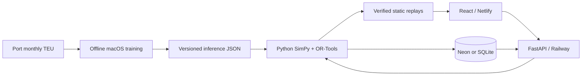

# System architecture

The browser projects playback from immutable run documents. Its only operational inputs are scenario choices, config revisions and interventions. FastAPI validates those requests and queues bounded CPU work in one request-driven worker. SimPy and the CP-SAT planner share domain and movement equations. Results, decision evidence and configurations commit as JSON documents in SQLite or PostgreSQL.

The legacy system combined CRA, Express/Socket.IO, Python ML, two representations of inventory, and a Unity counterpart. The new stack has one state authority, one backend process, generated contracts and a static offline experience. A future enterprise deployment would use a durable worker queue, tenant-scoped records, authenticated sessions and calibrated equipment contracts.
